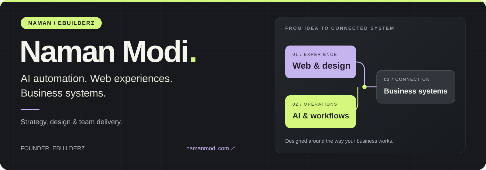

  

  <a href="https://www.namanmodi.com/"><strong>Personal website</strong></a> &nbsp; · &nbsp;
  <a href="https://www.ebuilderz.com/portfolio"><strong>Portfolio</strong></a> &nbsp; · &nbsp;
  <a href="https://www.linkedin.com/in/namanmodi/"><strong>LinkedIn</strong></a> &nbsp; · &nbsp;
  <a href="https://calendly.com/naman-modi-digital/general-meeting"><strong>Book a consultation ↗</strong></a>

## Hi, I'm Naman.

I'm an **AI & automation consultant** with a background in **web design and development**, based in Ludhiana, India. My career in web design and development began in **2012**. Today, my work connects websites, business software, automation and digital growth.

**Naman Modi is the person behind this profile; eBuilderz is the agency I founded and lead.** I personally handle planning, design, architecture, marketing strategy and client communication. My team carries out development under my supervision, with me as your main point of contact.

## What I bring to a project

| Focus | Work I lead |
| :--- | :--- |
| **AI & automation** | Business workflows, lead handling, website assistants and connected systems. |
| **Websites & commerce** | Website design, WordPress and Shopify projects, migrations and modern CMS experiences. |
| **Business software** | Custom ERP, inventory, HRMS, time tracking and task-management workflows. |
| **Search & growth** | Local SEO, analytics, conversion-focused journeys and healthcare digital marketing. |

### Technologies & tools across my work

**Design** &nbsp; Figma · UI/UX · Website architecture  
**Web & CMS** &nbsp; WordPress · WooCommerce · Shopify · PHP · React · Next.js · Sanity · Payload CMS  
**WordPress toolkit** &nbsp; Gutenberg · Elementor · ACF  
**Search & measurement** &nbsp; GA4 · Google Search Console · Google Tag Manager · CRO  
**AI-assisted work** &nbsp; ChatGPT · Codex · Claude

## Selected work

These public case studies and solution pages show the scope of our work at eBuilderz. My role follows the planning, design and supervised delivery model above.

| Project | What to explore |
| :--- | :--- |
| **[Med spa website](https://www.ebuilderz.com/portfolio/med-spa-website-redesign-development)** | A Next.js website and responsive booking journey for an aesthetic medicine business. |
| **[Art glass website migration](https://www.ebuilderz.com/portfolio/art-glass-website-redesign)** | Joomla to WordPress, with ACF, enquiry forms and a restructured product showcase. |
| **[Haircare Shopify store](https://www.ebuilderz.com/portfolio/haircare-product-website-redesign)** | Custom Shopify pages, app integrations and an improved shopping experience. |
| **[Cylinder inventory & operations](https://www.ebuilderz.com/solutions/cylinder-tracking-system)** | Filled/empty movements, customer and supplier ledgers, stock controls and reporting. |

**More systems:** [HRMS & workforce management](https://www.ebuilderz.com/solutions/custom-hrms-development) · [HeyTrigger: Instagram DM automation](https://www.ebuilderz.com/solutions/instagram-dm-automation) · [Curex: healthcare SEO tools](https://www.ebuilderz.com/solutions/curex-marketing-seo-tools)

## How we work together

**Understand the problem → Plan the system → Design the experience → Supervise delivery → Review and improve.**

I work with clients in the **US, UK and Canada**, remotely from India, on individual project and ongoing contracts. Production happens during India daytime; meetings are arranged by appointment.

Have a website, workflow or business system in mind? **[Book a free initial consultation](https://calendly.com/naman-modi-digital/general-meeting)** or email **[hello@namanmodi.com](mailto:hello@namanmodi.com)**.

Naman Modi &nbsp; / &nbsp; <a href="https://www.ebuilderz.com/">eBuilderz</a> &nbsp; / &nbsp; Strategy, design & team delivery

